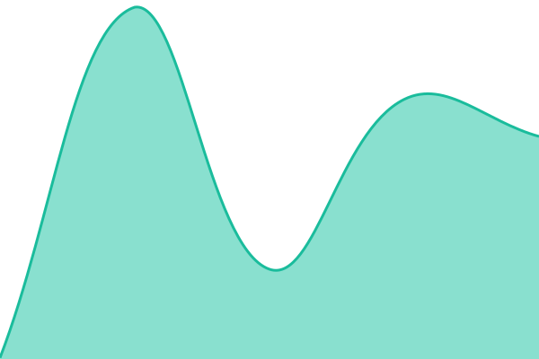
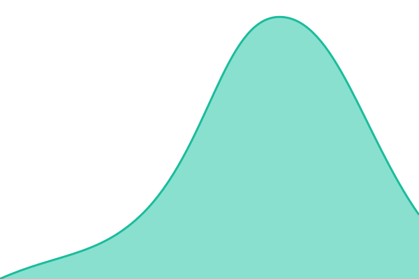

# [📈 Live Status](https://status.neurixone.com): <!--live status--> **🟩 All systems operational**

This repository contains the open-source uptime monitor and status page for [neurixone](https://status.neurixone.com), powered by [Upptime](https://github.com/upptime/upptime).

With [Upptime](https://upptime.js.org), you can get your own unlimited and free uptime monitor and status page, powered entirely by a GitHub repository. We use [Issues](https://github.com/neurixone/neurixone-status/issues) as incident reports, [Actions](https://github.com/neurixone/neurixone-status/actions) as uptime monitors, and [Pages](https://status.neurixone.com) for the status page.

<!--start: status pages-->
<!-- This summary is generated by Upptime (https://github.com/upptime/upptime) -->
<!-- Do not edit this manually, your changes will be overwritten -->
<!-- prettier-ignore -->
| URL | Status | History | Response Time | Uptime |
| --- | ------ | ------- | ------------- | ------ |
|  [Website](https://neurixone.com) | 🟩 Up | [website.yml](https://github.com/neurixone/neurixone-status/commits/HEAD/history/website.yml) | 

 185ms
     
 | 

<a href="https://status.neurixone.com/history/website">100.00%</a>
    

|  [Account and apps](https://account.neurixone.com) | 🟩 Up | [account-and-apps.yml](https://github.com/neurixone/neurixone-status/commits/HEAD/history/account-and-apps.yml) | 

 311ms
     
 | 

<a href="https://status.neurixone.com/history/account-and-apps">100.00%</a>
    

|  [Sign-in](https://auth.neurixone.com/.well-known/openid-configuration) | 🟩 Up | [sign-in.yml](https://github.com/neurixone/neurixone-status/commits/HEAD/history/sign-in.yml) | 

 931ms
     
 | 

<a href="https://status.neurixone.com/history/sign-in">100.00%</a>
    

|  [Neurix Live](https://live.neurixone.com) | 🟩 Up | [neurix-live.yml](https://github.com/neurixone/neurixone-status/commits/HEAD/history/neurix-live.yml) | 

 465ms
     
 | 

<a href="https://status.neurixone.com/history/neurix-live">100.00%</a>
    

<!--end: status pages-->

[**Visit our status website →**](https://status.neurixone.com)

## 📄 License

- Powered by: [Upptime](https://github.com/upptime/upptime)
- Code: [MIT](./LICENSE) © [Anand Chowdhary](https://anandchowdhary.com)
- Data in the `./history` directory: [Open Database License](https://opendatacommons.org/licenses/odbl/1-0/)
